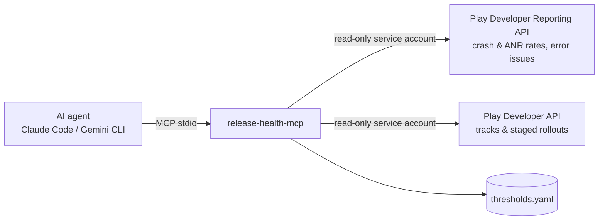

# Release Health MCP Server

[](https://github.com/drezzzik/release-health-mcp/actions/workflows/ci.yml)
[](LICENSE)

An [MCP](https://modelcontextprotocol.io) server that lets any AI agent (Claude Code, Claude Desktop, Gemini CLI, …) answer one question:

> **Is this release healthy enough to expand the rollout?**

It reads crash rate, ANR rate and top crashes per version from the Google Play Developer Reporting API and the staged-rollout state from the Play Developer API. It then recommends **expand**, **hold** or **halt** against your own thresholds.

The current version is **read-only**: it never changes a rollout. Approval-gated rollout changes are planned for milestone 3 (see [docs/ROADMAP.md](docs/ROADMAP.md)).



## Tools

| Tool | Returns |
|---|---|
| `list_releases(app?, track="production")` | Releases on a track: version codes, status (`inProgress`, `halted`, `completed`), `user_fraction` |
| `get_release_health(app?, version_code?)` | User-perceived crash and ANR rates, compared with the previous version that has data |
| `top_crashes(app?, version_code?, limit=5)` | Largest crash/ANR issues by affected users, each with a sample stack trace |
| `new_issues(app?, version_code?)` | Issues first seen in this version (likely regressions) |
| `recommend_rollout(app?, version_code?)` | `expand` / `hold` / `halt`, the reasons, and a suggested next rollout fraction |

`app` is an alias from `config.yaml` or a package name. If you omit `version_code`, the server uses the release currently rolling out on production. All tools return structured JSON and are annotated `readOnlyHint`.

## Quick start (demo data, no Google account needed)

```bash
# Python 3.12+ and uv required
uv sync
cp config.example.yaml config.yaml
cp thresholds.example.yaml thresholds.yaml
uv run pytest
```

### Connect to Claude Code
This repo ships a project-scoped `.mcp.json`, so starting `claude` in the repo picks up the server (approve it on first use). To register it globally instead:

```bash
claude mcp add release-health -e RELEASE_HEALTH_CONFIG=$PWD/config.yaml -- uv --directory $PWD run release-health-mcp
```

Then ask: *"Is the current rollout of `regressed` healthy enough to expand?"*

### Connect to Gemini CLI
Add this to `~/.gemini/settings.json`:

```json
{
  "mcpServers": {
    "release-health": {
      "command": "uv",
      "args": ["--directory", "/path/to/release-health-mcp", "run", "release-health-mcp"],
      "env": { "RELEASE_HEALTH_CONFIG": "/path/to/release-health-mcp/config.yaml" }
    }
  }
}
```

### Inspect by hand
`uv run mcp dev src/release_health_mcp/server.py` opens the MCP Inspector (requires Node.js).

## Using real Google Play data

1. In Google Cloud, enable the **Google Play Developer Reporting API** and the **Google Play Android Developer API**, then create a service account and a JSON key.
2. In Play Console → *Users and permissions*, invite the service account for the apps you want with exactly two permissions: **View app information (read-only)** (tracks and rollouts) and **View app quality information (read-only)** (Android vitals: crash/ANR rates and issues). Nothing under Releases. Don't reuse a CI/fastlane key that has release rights: least privilege matters, because milestone 3 adds a *separate* account for rollout changes.
3. In `config.yaml`:
   ```yaml
   backend: play
   apps:
     shop: com.example.shop
     tickets: com.example.tickets
   default_app: shop
   read_key_file: ~/.config/release-health/play-read-only.json
   ```
4. Sanity check: compare `get_release_health` with *Android vitals → Overview* in Play Console for the same version and window.

Environment overrides: `RELEASE_HEALTH_CONFIG`, `RELEASE_HEALTH_BACKEND`, `RELEASE_HEALTH_READ_KEY`, `RELEASE_HEALTH_THRESHOLDS`.

### How the numbers are computed
- **Rates** come from `crashRateMetricSet` / `anrRateMetricSet`, using daily rows for the `versionCode` dimension over the last `health_window_days` days of available data. Each rate is a user-weighted average. `user_days` is the summed daily distinct users and serves as the sample size.
- **Previous version** is the highest lower `versionCode` that has data in the same window.
- **New issues** are issues whose `firstAppVersion` (within `issues_window_days`) equals the version.

## Recommendation rules

The thresholds are in `thresholds.yaml` (defaults plus per-package overrides):

| Outcome | When |
|---|---|
| **halt** | User-perceived crash rate > `max_user_perceived_crash_rate` (default 1.09%) or ANR rate > `max_user_perceived_anr_rate` (default 0.47%), which are Google Play's bad-behavior thresholds |
| **hold** | Sample < `min_user_days`, no previous version to compare with, rate up more than `max_relative_increase` vs the previous version, or a new issue affecting more than `max_new_issue_users` users |
| **expand** | Otherwise. Suggests the next value in `rollout_steps`, capped at +`max_step_pp` (20 pp) |

The decision logic lives in `src/release_health_mcp/recommend.py`. It's a pure function with table-driven tests.

## Development

```bash
uv run pytest                        # unit, recorded-API and in-process MCP tests
uv run ruff check . && uv run ruff format --check .
uv run mypy src tests scripts        # strict
```

- `tests/recorded/` holds Play API responses that `PlayBackend` is tested against with `HttpMockSequence`, so no network access is needed.
- `scripts/record_responses.py --package <pkg> --key <json> --out tests/recorded/<name> --scrub` captures real responses for new tests (read-only calls only).

```
src/release_health_mcp/
  server.py        MCP tools (MCPServer, mcp SDK v2)
  service.py       composes backend + recommendation
  recommend.py     pure decision logic
  backends/        fixture (demo JSON) | play (Google APIs)
  config.py, thresholds.py, models.py
```

## Roadmap
See [docs/ROADMAP.md](docs/ROADMAP.md): approval-gated `propose_rollout_change` (human approval, hard limits, audit log, dry-run by default), then the showcase, iOS, remote HTTP and tracing.

## License
MIT, see [LICENSE](LICENSE).
